# Database Design — AI-Assisted Resume Builder

## 1. Overview
The database layer uses **PostgreSQL 16** managed via **Prisma ORM**. All primary keys are UUIDs. Relational cascading deletes ensure clean data cleanup without orphaned records.

---

## 2. Entity Relationship Diagram

```mermaid
erDiagram
    User ||--o{ Resume : "owns (1:N, cascade)"
    User ||--o{ CoverLetter : "owns (1:N, cascade)"
    Resume ||--o{ Education : "contains (1:N, cascade)"
    Resume ||--o{ Experience : "contains (1:N, cascade)"
    Resume ||--o{ Project : "contains (1:N, cascade)"
    Resume ||--o{ Skill : "contains (1:N, cascade)"
    Resume ||--o{ Certification : "contains (1:N, cascade)"
    Resume ||--o{ Achievement : "contains (1:N, cascade)"
    Resume ||--o{ Language : "contains (1:N, cascade)"
    Resume ||--o{ ResumeAnalysis : "evaluated by (1:N, cascade)"
    Resume ||--o{ JobMatch : "matched by (1:N, cascade)"

    User {
        String id PK "UUID"
        String email UK "Unique, lowercased"
        String password "Bcrypt hash"
        String first_name
        String last_name
        DateTime created_at
        DateTime updated_at
    }

    Resume {
        String id PK "UUID"
        String user_id FK "References User(id)"
        String title "Default: Untitled Resume"
        String template_id "classic | modern | creative"
        String full_name
        String email
        String phone
        String location
        String linkedin
        String github
        String website
        String summary
        DateTime created_at
        DateTime updated_at
    }

    Education {
        String id PK "UUID"
        String resume_id FK "References Resume(id)"
        String institution
        String degree
        String field
        String start_date
        String end_date
        String gpa
        String description
        Int sort_order
    }

    Experience {
        String id PK "UUID"
        String resume_id FK "References Resume(id)"
        String company
        String position
        String location
        String start_date
        String end_date
        Boolean current
        String description
        Int sort_order
    }

    Project {
        String id PK "UUID"
        String resume_id FK "References Resume(id)"
        String name
        String description
        String technologies
        String link
        String start_date
        String end_date
        Int sort_order
    }

    Skill {
        String id PK "UUID"
        String resume_id FK "References Resume(id)"
        String category "Default: General"
        String name
        String level "Beginner | Intermediate | Advanced | Expert"
    }

    Certification {
        String id PK "UUID"
        String resume_id FK "References Resume(id)"
        String name
        String issuer
        String date
        String expiry_date
        String credential_id
        String url
    }

    Achievement {
        String id PK "UUID"
        String resume_id FK "References Resume(id)"
        String title
        String description
        String date
        Int sort_order
    }

    Language {
        String id PK "UUID"
        String resume_id FK "References Resume(id)"
        String name
        String proficiency "Native | Fluent | Advanced | Intermediate | Basic"
    }

    CoverLetter {
        String id PK "UUID"
        String user_id FK "References User(id)"
        String resume_id "Optional reference"
        String company_name
        String job_role
        String job_description
        String content
        DateTime created_at
        DateTime updated_at
    }

    ResumeAnalysis {
        String id PK "UUID"
        String resume_id FK "References Resume(id)"
        Int score "0-100"
        Json results "Structured analysis breakdown"
        DateTime created_at
    }

    JobMatch {
        String id PK "UUID"
        String resume_id FK "References Resume(id)"
        String job_title
        String job_description
        Int match_score "0-100"
        Json results "Matched/missing keywords"
        DateTime created_at
    }
```

---

## 3. Key Design Principles
1. **User Isolation**: All queries enforce `where: { userId }` or `where: { id, userId }` to prevent horizontal privilege escalation.
2. **Cascade Deletes**: Deleting a User automatically cascades to delete all their Resumes and CoverLetters. Deleting a Resume automatically cascades to all associated Education, Experience, Project, Skill, Certification, Achievement, Language, Analysis, and JobMatch records.
3. **Atomic Multi-Entity Sync**: Updating a resume's nested sections is executed in an atomic Prisma transaction (`prisma.$transaction`).
